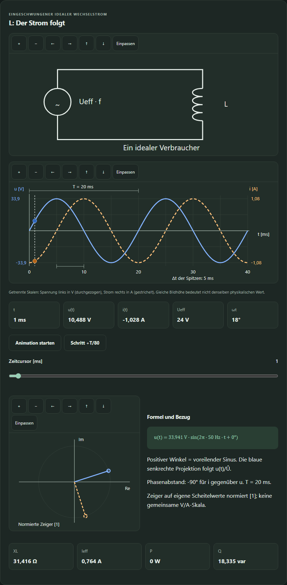
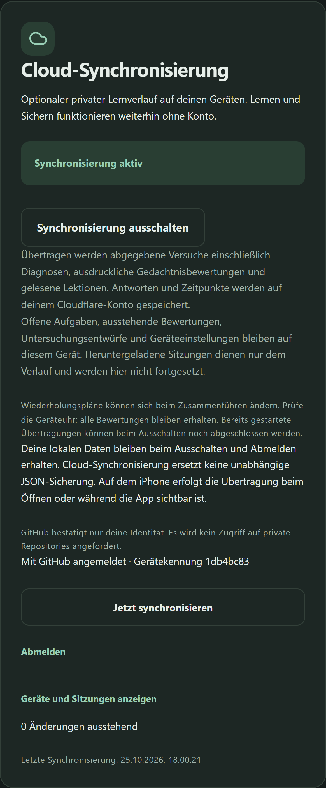
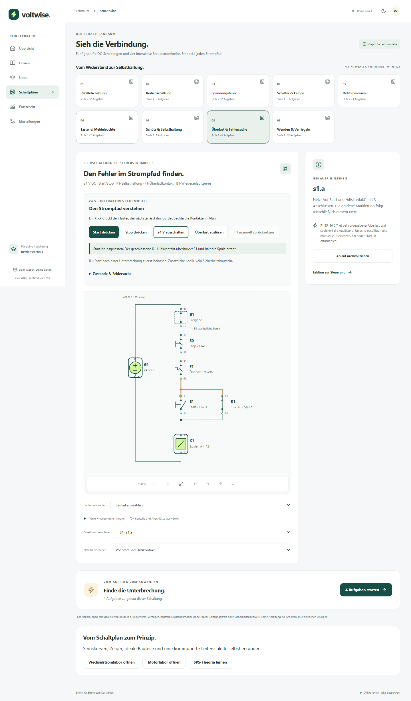
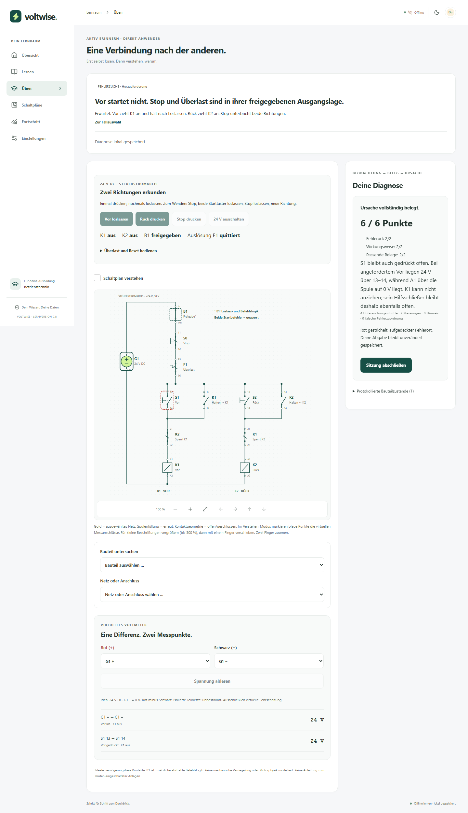

# Voltwise

**Verstehen. Anwenden. Weiterkommen.** A German-first learning PWA for an Elektroniker für Betriebstechnik apprenticeship. It combines short lessons, active recall, numeric exercises and structured, interactive SVG schematics. Core learning works locally without an account, Obsidian or GitHub access.

[Open Voltwise](https://maxello1.github.io/voltwise/) · Install from your browser after the first online load.


## Run locally

Use **Node 24.14 or newer** and **pnpm 11.25.0** (declared in package.json).

```powershell
cd 'D:\Lern App'
pnpm install --frozen-lockfile
pnpm dev
```

Open the URL printed by Vite. The provided workspace is used directly; the project did not move the supplied planning documents or create a second checkout elsewhere.

```text
pnpm lint          # ESLint, no warnings allowed
pnpm typecheck     # strict TypeScript
pnpm test          # domain and IndexedDB/component integration tests
pnpm build         # production assets, manifest and offline service worker
pnpm preview       # production preview; required for offline verification
pnpm test:e2e      # build first; isolated Chromium phone and desktop tests
pnpm icons         # regenerate original PWA artwork
```

For browser tests, install Chromium once with `pnpm exec playwright install chromium`. This workspace's verification uses `PLAYWRIGHT_BROWSERS_PATH=D:\Lern App\.cache\playwright`; set that environment variable if reusing the local download. Visual baselines are OS-specific; Windows baselines ship with the first version, and Linux CI skips the visual comparison until a native baseline is reviewed. Functional browser checks still run on Linux.

## Included now

- Six responsive sections: Übersicht, Lernen, Üben, Schaltpläne, Fortschritt and Einstellungen; desktop sidebar and phone bottom navigation.
- 21 German lessons and **136 checked curated exercises**, including choices, typed recall, unit-aware calculations, waveform/phasor construction, motor component selection, multi-step applications and twelve diagnostic investigations.
- A DC calculation trainer with five reproducible numeric templates, matching series/parallel diagrams, shareable round codes and offline backup/restore support.
- Atomic IndexedDB persistence through Dexie, resumable sessions, immutable attempts/review events and separate explicit FSRS memory ratings.
- Stable `ts-fsrs@5.4.2` behind an adapter, a due queue, actual activity and an explained practice metric.
- Concept recommendations with real sample counts, shareable targeted practice and an explained five-task preview. The mixed selection respects read prerequisites and keeps future scheduled facts on their own timetable.
- **Five analytically verified DC circuits**: parallel, series, unloaded voltage divider, switched idealized lamp and ideal meter placement. Includes original SVG symbols, keyboard/component/terminal selection, net highlighting, zoom, pan and fit.
- **Four interactive 24 V control circuits**: momentary lamp, K1 self-holding, overload/reset and mutually interlocked forward/reverse contactors. Includes explicit B1 release/command permission and signed virtual DC voltage measurements for the fixed reversing topology.
- **Fehlersuche**: six genuine injected fault/permission cases, three levels, persisted investigations, electrical measurement evidence and a transparent 6-point diagnosis rubric. Distinct-case coverage stays separate from FSRS memory ratings.
- Version-3 JSON export/import, with version-1/2 compatibility, preserved remote session descriptors and additive, idempotent events; readable Markdown lesson export.
- Optional single-owner Cloudflare Worker/D1 synchronization with identity-only GitHub login, persistent outbox, immutable history, device revocation and deterministic review reconciliation. Explicit consent and production setup are required.
- Light/dark/system themes, local daily goal, installation guidance and an offline app shell that precaches lesson/code assets, including lazy-loaded screens.

GitHub Pages remains the **local-only edition**. The synchronized edition requires a deliberate same-origin Cloudflare deployment; it has been tested locally, not deployed to a production account. There is no automatic GitHub backup, general industrial network simulator or complete apprenticeship curriculum. The private data repository remains untouched. Browser/cloud storage is not an independent backup; export regularly. Install/read the app online once and wait for **Offline bereit** before relying on airplane-mode access. The development server does not register the production service worker.

## Schulstoff, Wechselstrom und Motoren — v0.8

Open **Lernen** for 15 new focused lessons and 75 new tasks: six AC units, five DC-machine units and four SPS theory units. The grouped topic selector keeps every subject accessible. Prerequisites are recommendations; new lessons and concepts start without invented completion or mastery.

**Schaltpläne → Wechselstromlabor** connects adjustable sine curves, a draggable time cursor, RMS/peak values, signed phases, synchronized phasors and ideal R/L/C circuits. Compare two voltages, predict frequency effects and construct a physical voltage-vector endpoint. Voltage/current plots label separate V/A scales; reactive power uses positive inductive and negative capacitive var.

**Schaltpläne → Motorlabor** shows seven selectable parts, prescribed/stepped rotor motion, current reversal, neutral positions, force and angle-dependent torque. Compare operation with/without the ideal split ring, reverse field/supply, calculate counter-EMF current and inspect five excitation topologies. Rotation is a teaching animation, not a calculated startup/load transient.

SPS is **theory and learning exercises**, as requested: active-low inputs, AND/OR/NOT, the complete 16-case generator table, both rejected 10-kW boundaries, a checked static FUP and the historical TIA/FC/OB1/PLCSIM workflow. There is no SPS laboratory or FUP editor.



Sixteen new reproducible numeric families use immutable `ac1`, `motor1` and `plc1` IDs; existing `dc1` IDs remain unchanged. [AC round](https://maxello1.github.io/voltwise/#/ueben?trainer=ac&code=000000) · [Motor round](https://maxello1.github.io/voltwise/#/ueben?trainer=motor&code=000000) · [SPS calculation round](https://maxello1.github.io/voltwise/#/ueben?trainer=plc&code=000000).

Only explicit answer submission records an attempt. Exploration is ephemeral, graded feedback resumes offline, and calculation/application scores remain separate from explicit FSRS memory ratings. Database schema 3 and backup format 3 are unchanged; old migrations and backup 1/2 imports remain supported. The supplied specification defines the coursework scope; source scans were unavailable and are not published. See [curriculum, equations, references, limits and compatibility](docs/SCHOOL_CURRICULUM.md).

## Optional secure synchronization — v0.7

In a configured Cloudflare edition, open **Einstellungen → Cloud-Synchronisierung**, sign in with the allowed GitHub account and explicitly consent to storing history. Submitted attempts (including diagnoses), separate memory ratings and lesson completion events merge across devices. Learning saves locally before any network operation. Failed/quota-limited uploads remain queued; a successful timestamp requires persisted server acknowledgments and completed downloads. Repeated deliveries do not duplicate events, and all concurrent reviews survive deterministic FSRS replay.

Active sessions, pending ratings, diagnostic drafts and preferences remain device-local. Signing out never erases local learning data. Sync runs while the app is visible and on reconnect/foreground; always-on iOS background execution is not promised. The GitHub login requests no private-repository scope. Account secrets remain on the Worker; there are no browser-stored long-lived auth tokens. The system uses TLS and provider storage controls, not end-to-end encryption.

GitHub Pages and Cloudflare have separate IndexedDB storage. Move existing progress deliberately using JSON export/import; there is no silent redirect or storage migration. See [deployment and exact prerequisites](docs/CLOUD_DEPLOYMENT.md), [data migration/recovery](docs/DATA_MIGRATION.md), [protocol](docs/SYNC_PROTOCOL.md), [review ordering/design](docs/SYNC_DESIGN.md) and [security](docs/SECURITY.md).

`pnpm test` includes real local Worker/D1 integration tests with three independent device databases. `pnpm test:e2e` checks the local-only app and a separate same-origin cloud test server; GitHub identity is synthetic in automated tests. `pnpm build:cloud` produces the root-path synchronized PWA. Neither tests nor builds deploy it. Physical iPhone Safari/Windows/macOS installation and real OAuth/Cloudflare acceptance remain manual.



The capture shows the actual local Worker/D1 test with synthetic GitHub identity, not a production login. Navigation is hidden for the isolated settings-card capture.


Each static DC circuit has a shareable URL and its own two or three practice tasks. Existing unfinished sessions resume first. The lamp example assumes a fixed 60 Ω resistance and a closed ideal switch; the meter example assumes an ideal series ammeter and a parallel voltmeter drawing no current. These checked static teaching models are not dynamic simulations.

## Interactive control circuits

Open **Schaltpläne → Taster & Meldeleuchte → Schütz & Selbsthaltung → Überlast & Fehlersuche** for the progressive control examples. Press and release Start/Stop, interrupt 24 V, trip F1, remove the cause and reset manually. Contact geometry, coil/lamp highlighting and German explanations follow the deterministic state. Zoom to 300%, pan, select components or use the touch selectors.

B1 explicitly adds release-before-restart behavior after Stop, overload or supply interruption. An ordinary self-holding circuit alone can restart with Start held; the lesson explains this distinction. The model is ideal and instantaneous, with no motor power circuit or safety certification. Exploratory circuit states reset when reopened; learning attempts persist. Nine applied tasks stay outside FSRS; the separate contact fact offers an explicit memory rating. See [control model, assumptions and tests](docs/CONTROL_CIRCUITS.md).



## Interactive fault diagnosis — v0.6

Open **Üben → Fehlersuche öffnen** or **Schaltpläne → Wenden & Verriegeln**. Operate Vor/Rück/Stop, select contacts/nets/terminals, record inspections and choose two virtual voltage probes. Diagnose the location and causal mechanism using electrical evidence. Hints are optional; advanced cases also require a relevant component-state observation. The real fault outline appears only after submission. A correct guess without evidence earns partial credit.



The reversing model has explicit NO holding contacts, opposing NC interlocks, common Stop/overload and additional B1 command arbitration. Simultaneous Start commands inhibit both coils. Direction change requires Stop, release and a new Start. There is no mechanical interlock physics or motor power simulation. Measurements use fixed terminal connectivity and ideal DC potentials, including signed values and undefined floating potentials; source loss is explicitly a 0 V output in this bounded model.

Unsubmitted investigations survive navigation/reload; only explicit submission appends a learning attempt. Dexie migration 2 introduced drafts while preserving all older events/queues. v0.6 exported backup 2; v0.7 exports backup 3 and still imports v1/v2. Restore v0.7 backups with v0.7 or newer. All functionality works offline after the production cache is ready. See [diagnostic architecture, rubric, assumptions and compatibility](docs/DIAGNOSTICS.md).

## Targeted practice


Recommendations use the last twenty attempts per concept and count only unassisted correct answers as independently correct. Small samples are labeled as preliminary. They select practice, while your explicit memory rating alone updates FSRS. Recall accepts declared aliases and consistent pairs such as `Ohm (Ω)`; it does not infer meaning from arbitrary sentences.

## Calculation rounds

Open **Üben → Rechentrainer öffnen** to practice Ohm's law, power, series and parallel circuits with changing numbers. A six-digit code identifies the same five tasks on every device. Sharing the round link includes the code, not your answers or progress. Past calculation attempts link back to their round.

[Try round 000000](https://maxello1.github.io/voltwise/#/ueben?trainer=dc&code=000000)


Each generated question uses checked, bounded ideal DC assumptions and a stated 0.1% numeric tolerance. Answers are recorded as application practice, without adding FSRS memory cards. See [generated practice](docs/GENERATED_PRACTICE.md) for the supported equations and immutable version contract.

## Electrical reference example

For ideal 100 Ω and 200 Ω parallel branches at 24 V:

| Quantity              | Result    |
| --------------------- | --------- |
| R1 current            | 0.24 A    |
| R2 current            | 0.12 A    |
| Total current         | 0.36 A    |
| Equivalent resistance | 66.666… Ω |
| Total power           | 8.64 W    |

The domain tests verify Ohm's law, current conservation, equivalent resistance and power balance. Educational diagrams are not instructions for working on electrical installations.

## Repositories and deployment

- Code: [Maxello1/voltwise](https://github.com/Maxello1/voltwise)
- Private archive: [Maxello1/voltwise-data](https://github.com/Maxello1/voltwise-data)

GitHub Pages uses `.github/workflows/deploy.yml`. Every main-branch deployment first runs lint, strict typing, unit/integration tests, a production build and functional browser tests. The Vite base, manifest scope and test URLs derive from `GITHUB_REPOSITORY`, so a project deployment uses `/voltwise/`. Hash routing allows direct refresh without a static-host 404. Set `VITE_BASE_PATH=/` only for a root/custom-domain deployment and rebuild.

Pages must use **Settings → Pages → Source: GitHub Actions**. Repository creation and activation can use the existing Git credential helper; the GitHub CLI is optional. `scripts/setup-github.mjs` checks names before creation and never overwrites existing repositories. Its credentials stay in memory, outside application code and build assets.

## Project notes

- [Roadmap](docs/ROADMAP.md) retains the supplied long-term specification; its milestones are not a completion claim.
- [Delivery status and backlog](docs/BACKLOG.md) distinguishes this first usable slice from later alpha work.
- [Architecture](docs/ARCHITECTURE.md), [circuit schema](docs/CIRCUIT_SCHEMA.md), [control circuits](docs/CONTROL_CIRCUITS.md), [diagnostics](docs/DIAGNOSTICS.md), [learning model](docs/LEARNING_MODEL.md), [sync design](docs/SYNC_DESIGN.md), [security](docs/SECURITY.md), [verification](docs/VERIFICATION.md).
- [Decisions](docs/DECISIONS.md), [changelog](CHANGELOG.md), [license decision](LICENSE).

Stable npm releases were checked on 21 October 2026. TypeScript 6.0.3 is used because the current TypeScript ESLint parser supports `<6.1`; jsdom 29.1.1 supports the installed Node 24.14.1, while jsdom 30 requires a newer patch version. Exact dependencies and transitive resolutions are committed in the pnpm lockfile.
