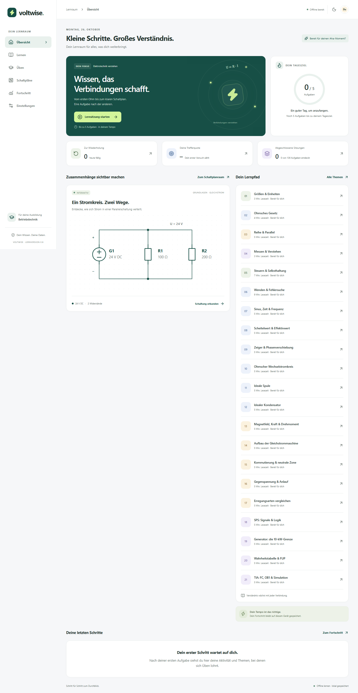
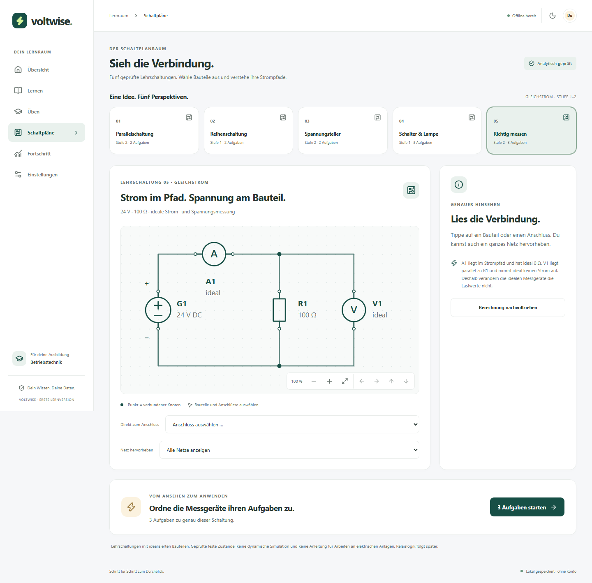
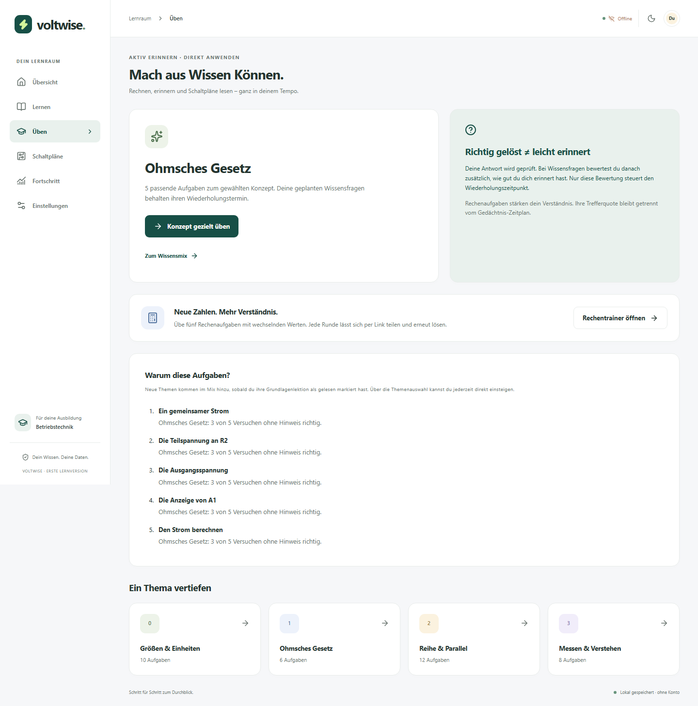
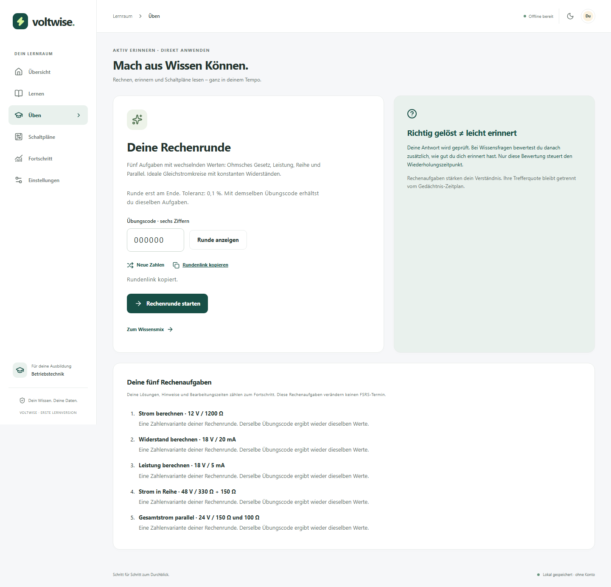

# Voltwise

**Verstehen. Anwenden. Weiterkommen.** A German-first learning PWA for an Elektroniker für Betriebstechnik apprenticeship. It combines short lessons, active recall, numeric exercises and structured, interactive SVG schematics. Core learning works locally without an account, Obsidian or GitHub access.

[Open Voltwise](https://maxello1.github.io/voltwise/) · Install from your browser after the first online load.



## Run locally

Use **Node 24.14 or newer** and **pnpm 11.25.0** (declared in package.json).

```powershell
cd 'D:\Lern App'
pnpm install --frozen-lockfile
pnpm dev
```

Open the URL printed by Vite. The provided workspace is used directly; the project did not move the supplied planning documents or create a second checkout elsewhere.

```text
pnpm lint          # ESLint, no warnings allowed
pnpm typecheck     # strict TypeScript
pnpm test          # domain and IndexedDB/component integration tests
pnpm build         # production assets, manifest and offline service worker
pnpm preview       # production preview; required for offline verification
pnpm test:e2e      # build first; isolated Chromium phone and desktop tests
pnpm icons         # regenerate original PWA artwork
```

For browser tests, install Chromium once with `pnpm exec playwright install chromium`. This workspace's verification uses `PLAYWRIGHT_BROWSERS_PATH=D:\Lern App\.cache\playwright`; set that environment variable if reusing the local download. Visual baselines are OS-specific; Windows baselines ship with the first version, and Linux CI skips the visual comparison until a native baseline is reviewed. Functional browser checks still run on Linux.

## Included now

- Six responsive sections: Übersicht, Lernen, Üben, Schaltpläne, Fortschritt and Einstellungen; desktop sidebar and phone bottom navigation.
- Four lessons and **36 checked starter exercises**, including choices, typed recall, unit-aware calculations and component selection.
- A DC calculation trainer with five reproducible numeric templates, matching series/parallel diagrams, shareable round codes and offline backup/restore support.
- Atomic IndexedDB persistence through Dexie, resumable sessions, immutable attempts/review events and separate explicit FSRS memory ratings.
- Stable `ts-fsrs@5.4.2` behind an adapter, a due queue, actual activity and an explained practice metric.
- Concept recommendations with real sample counts, shareable targeted practice and an explained five-task preview. The mixed selection respects read prerequisites and keeps future scheduled facts on their own timetable.
- **Five analytically verified DC circuits**: parallel, series, unloaded voltage divider, switched idealized lamp and ideal meter placement. Includes original SVG symbols, keyboard/component/terminal selection, net highlighting, zoom, pan and fit.
- Validated version-1 JSON export/import with additive, idempotent events; readable Markdown lesson export.
- Light/dark/system themes, local daily goal, installation guidance and an offline app shell that precaches lesson/code assets, including lazy-loaded screens.

There is **no cloud synchronization, automatic GitHub backup, industrial simulator or complete apprenticeship curriculum** yet. The private data repository contains documentation only. Browser storage is not a long-term backup; export regularly. Install/read the app online once and wait for **Offline bereit** before relying on airplane-mode access. The development server does not register the production worker.



The selected circuit has a shareable URL and its own two or three practice tasks. Existing unfinished sessions resume first. The lamp example assumes a fixed 60 Ω resistance and a closed ideal switch; the meter example assumes an ideal series ammeter and a parallel voltmeter drawing no current. These checked static teaching models are not dynamic simulations.

## Targeted practice



Recommendations use the last twenty attempts per concept and count only unassisted correct answers as independently correct. Small samples are labeled as preliminary. They select practice, while your explicit memory rating alone updates FSRS. Recall accepts declared aliases and consistent pairs such as `Ohm (Ω)`; it does not infer meaning from arbitrary sentences.

## Calculation rounds

Open **Üben → Rechentrainer öffnen** to practice Ohm's law, power, series and parallel circuits with changing numbers. A six-digit code identifies the same five tasks on every device. Sharing the round link includes the code, not your answers or progress. Past calculation attempts link back to their round.

[Try round 000000](https://maxello1.github.io/voltwise/#/ueben?trainer=dc&code=000000)



Each generated question uses checked, bounded ideal DC assumptions and a stated 0.1% numeric tolerance. Answers are recorded as application practice, without adding FSRS memory cards. See [generated practice](docs/GENERATED_PRACTICE.md) for the supported equations and immutable version contract.

## Electrical reference example

For ideal 100 Ω and 200 Ω parallel branches at 24 V:

| Quantity              | Result    |
| --------------------- | --------- |
| R1 current            | 0.24 A    |
| R2 current            | 0.12 A    |
| Total current         | 0.36 A    |
| Equivalent resistance | 66.666… Ω |
| Total power           | 8.64 W    |

The domain tests verify Ohm's law, current conservation, equivalent resistance and power balance. Educational diagrams are not instructions for working on electrical installations.

## Repositories and deployment

- Code: [Maxello1/voltwise](https://github.com/Maxello1/voltwise)
- Private archive: [Maxello1/voltwise-data](https://github.com/Maxello1/voltwise-data)

GitHub Pages uses `.github/workflows/deploy.yml`. Every main-branch deployment first runs lint, strict typing, unit/integration tests, a production build and functional browser tests. The Vite base, manifest scope and test URLs derive from `GITHUB_REPOSITORY`, so a project deployment uses `/voltwise/`. Hash routing allows direct refresh without a static-host 404. Set `VITE_BASE_PATH=/` only for a root/custom-domain deployment and rebuild.

Pages must use **Settings → Pages → Source: GitHub Actions**. Repository creation and activation can use the existing Git credential helper; the GitHub CLI is optional. `scripts/setup-github.mjs` checks names before creation and never overwrites existing repositories. Its credentials stay in memory, outside application code and build assets.

## Project notes

- [Roadmap](docs/ROADMAP.md) retains the supplied long-term specification; its milestones are not a completion claim.
- [Delivery status and backlog](docs/BACKLOG.md) distinguishes this first usable slice from later alpha work.
- [Architecture](docs/ARCHITECTURE.md), [circuit schema](docs/CIRCUIT_SCHEMA.md), [learning model](docs/LEARNING_MODEL.md), [sync design](docs/SYNC_DESIGN.md), [security](docs/SECURITY.md), [verification](docs/VERIFICATION.md).
- [Decisions](docs/DECISIONS.md), [changelog](CHANGELOG.md), [license decision](LICENSE).

Stable npm releases were checked on 21 October 2026. TypeScript 6.0.3 is used because the current TypeScript ESLint parser supports `<6.1`; jsdom 29.1.1 supports the installed Node 24.14.1, while jsdom 30 requires a newer patch version. Exact dependencies and transitive resolutions are committed in the pnpm lockfile.
